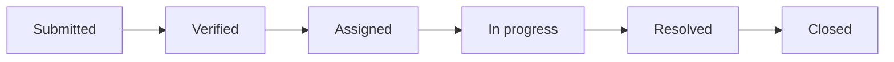
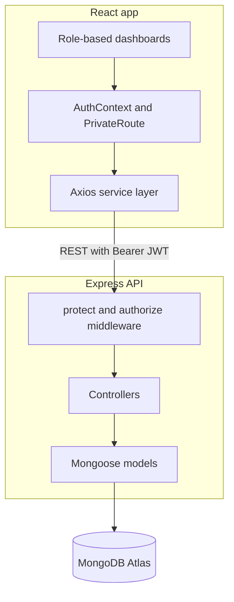

<div align="center">

<h1>NagarSetu</h1>

<p><b>नगरसेतु</b> · The City Bridge</p>

<p>
A civic issue reporting platform where citizens report problems,<br>
administrators route them, and officers fix them, with every step tracked.
</p>

<p>
  
  
  
  
  
</p>

<p>
  <a href="https://nagarsetu-gamma.vercel.app/"></a>
  <a href="https://github.com/Adi-Marathe/Nagarsetu/issues"></a>
  
</p>

</div>

## About

Most of us have walked past a pothole or a dead street light and thought someone should report it. The harder part is knowing who to report it to, and whether anything happens afterwards.

NagarSetu is built around that gap. A citizen files a report with photos and a pin on the map. An administrator checks it and sends it to the right department. An officer takes it up, updates the progress, and marks it resolved. The citizen is notified at each stage and can rate the outcome at the end.

The app is deployed at [nagarsetu-gamma.vercel.app](https://nagarsetu-gamma.vercel.app/). The frontend runs on Vercel, the backend on Render, and the data lives in MongoDB Atlas.

## Features

**Citizens**
- Report an issue with a title, description, category, priority, photos, and an exact location picked on a map
- Follow each complaint from submission to closure
- Get notified whenever its status changes
- Upvote other people's complaints so urgent ones stand out
- Comment on complaints and rate the resolution from 1 to 5

**Administrators**
- Review and verify new complaints
- Assign verified complaints to a department officer
- See analytics for categories, statuses, and trends over time
- Manage officers and departments

**Officers**
- See every complaint assigned to them
- Mark a complaint as in progress and leave notes
- Resolve it, which notifies the citizen automatically
- Check personal stats: assigned, in progress, resolved, and closed

## How a Complaint Moves



The status values are `submitted`, `verified`, `assigned`, `in_progress`, `resolved`, and `closed`. Each change is saved in the complaint's `timeline`, so there is always a record of who did what and when.

## Tech Stack

| Layer | Technologies |
|---|---|
| Frontend | React 19, Vite 8, React Router 7, Axios, React-Leaflet, Bootstrap, Lucide, React-Toastify |
| Backend | Node.js, Express 5, Mongoose 9, JSON Web Tokens, bcryptjs |
| Database | MongoDB Atlas |
| Hosting | Vercel (client), Render (server) |

## Architecture



## Project Structure

```
nagarsetu/
├── client/
│   ├── src/
│   │   ├── components/              Reusable UI components
│   │   ├── context/AuthContext.jsx  Global auth state
│   │   ├── pages/
│   │   │   ├── Admin/               Dashboard, VerifyIssues, AssignOfficers
│   │   │   ├── Auth/                Login, Signup
│   │   │   ├── Citizen/             Dashboard, ReportIssue, MyComplaints, Details
│   │   │   ├── LandingPage/         Public landing page
│   │   │   └── Officer/             Dashboard, OfficerWork
│   │   ├── routes/PrivateRoute.jsx  Role-based route guards
│   │   └── services/api.js          Axios client
│   └── .env.example
└── server/
    ├── src/
    │   ├── config/
    │   │   ├── db.js                MongoDB connection
    │   │   └── seedDepartments.js   Seeds departments and the admin user
    │   ├── controllers/             Business logic for each route group
    │   ├── middleware/auth.js       Token check and role check
    │   ├── models/                  User, Complaint, Department, Comment, Notification
    │   └── routes/                  Express routes
    ├── server.js                    Entry point
    └── .env.example
```

## Getting Started

You will need Node.js 18 or newer, Git, and a MongoDB Atlas cluster (the free tier is enough).

**1. Clone the repository and install dependencies**

```bash
git clone https://github.com/Adi-Marathe/Nagarsetu.git
cd Nagarsetu

cd server && npm install
cd ../client && npm install
```

**2. Set up the environment files**

```bash
cp server/.env.example server/.env
cp client/.env.example client/.env
```

Then fill in the values listed under [Environment Variables](#environment-variables).

**3. Start both servers**

Run these in two separate terminals.

```bash
cd server && npm run dev
```

```bash
cd client && npm run dev
```

Open `http://localhost:5173`. The first time the server starts, it creates six departments and a default admin account.

**Default admin login (local development only)**

| Email | Password |
|---|---|
| `admin@nagarsetu.local` | `Admin@123` |

Before deploying, set `ADMIN_EMAIL` and `ADMIN_PASSWORD` to your own values.

## Environment Variables

**server/.env**

| Variable | Purpose |
|---|---|
| `MONGO_URI` | MongoDB Atlas connection string |
| `JWT_SECRET` | Secret used to sign login tokens |
| `PORT` | Port for the API, `5000` by default |
| `NODE_ENV` | `development` or `production` |
| `CLIENT_ORIGIN` | Frontend URL allowed by CORS |
| `ADMIN_EMAIL` | Optional. Email for the seeded admin |
| `ADMIN_PASSWORD` | Optional. Password for the seeded admin |

To generate a strong `JWT_SECRET`:

```bash
node -e "console.log(require('crypto').randomBytes(64).toString('hex'))"
```

**client/.env**

| Variable | Purpose |
|---|---|
| `VITE_API_URL` | Base URL of the backend, for example `http://localhost:5000/api` |

## API Reference

All routes start with `/api`. Protected routes need an `Authorization: Bearer <token>` header.

<details>
<summary>Auth</summary>

| Method | Endpoint | Access | Description |
|---|---|---|---|
| POST | `/auth/register` | Public | Register a new user |
| POST | `/auth/login` | Public | Log in and receive a JWT |
| GET | `/auth/profile` | Authenticated | Get the current user |
| PUT | `/auth/profile` | Authenticated | Update the profile |

</details>

<details>
<summary>Complaints</summary>

| Method | Endpoint | Access | Description |
|---|---|---|---|
| POST | `/complaints` | Citizen | Create a complaint |
| GET | `/complaints` | Authenticated | List complaints, filtered by role |
| GET | `/complaints/all` | Admin | List all complaints |
| GET | `/complaints/:id` | Authenticated | Get one complaint |
| PUT | `/complaints/:id/status` | Admin, Officer | Update the status |
| PUT | `/complaints/:id/upvote` | Authenticated | Toggle an upvote |
| PUT | `/complaints/:id/feedback` | Citizen | Rate a resolved complaint |

</details>

<details>
<summary>Admin</summary>

| Method | Endpoint | Access | Description |
|---|---|---|---|
| GET | `/admin/stats` | Admin | Dashboard statistics |
| PUT | `/admin/verify/:id` | Admin | Verify a complaint |
| PUT | `/admin/assign/:id` | Admin | Assign a complaint to an officer |
| GET | `/admin/officers` | Admin | List officers |
| GET | `/admin/departments` | Admin | List departments |

</details>

<details>
<summary>Officer</summary>

| Method | Endpoint | Access | Description |
|---|---|---|---|
| GET | `/officer/complaints` | Officer | Complaints assigned to the officer |
| GET | `/officer/stats` | Officer | Personal stats |
| PUT | `/officer/progress/:id` | Officer | Mark a complaint in progress |
| PUT | `/officer/resolve/:id` | Officer | Resolve a complaint |

</details>

<details>
<summary>Comments and Notifications</summary>

| Method | Endpoint | Access | Description |
|---|---|---|---|
| POST | `/comments/:complaintId` | Authenticated | Add a comment |
| GET | `/comments/:complaintId` | Authenticated | Get comments on a complaint |
| GET | `/notifications` | Authenticated | Get notifications |
| PUT | `/notifications/:id/read` | Authenticated | Mark one as read |
| PUT | `/notifications/read-all` | Authenticated | Mark all as read |

</details>

## Database Models

| Model | What it stores |
|---|---|
| User | Name, email, hashed password, role (`citizen`, `admin` or `officer`), phone, department |
| Complaint | Title, description, category (19 types), status, priority, location (address and coordinates), images, citizen, department, assigned officer, upvotes, timeline, feedback, resolved time |
| Department | Name, code, description, categories, head, contact details |
| Comment | The complaint, the author, the text, timestamps |
| Notification | The user, title, message, type, read status, and the related complaint |

Six departments are created on first run: Public Works (`PWD`), Sanitation (`SAN`), Water Supply (`WSD`), Electricity (`ELEC`), Health (`HEALTH`) and Transport (`TRANS`).

## Deployment

**Frontend on Vercel**

1. Import the repository and set the root directory to `client`.
2. Add the variable `VITE_API_URL` with your backend URL, for example `https://your-backend.onrender.com/api`.
3. Deploy.

**Backend on Render**

1. Create a new Web Service and set the root directory to `server`.
2. Use `npm install` as the build command and `npm start` as the start command.
3. Add `MONGO_URI`, `JWT_SECRET`, `CLIENT_ORIGIN` (your Vercel URL), `NODE_ENV=production`, `ADMIN_EMAIL` and `ADMIN_PASSWORD`.
4. Deploy.

## Security

- Passwords are hashed with bcrypt (10 salt rounds) and left out of query results by default.
- Login tokens are JWTs that expire after 30 days and are verified on every protected route.
- The `protect` middleware checks the token and `authorize` checks the user's role.
- CORS only allows the origins listed in the configuration.
- Responses send the `X-Content-Type-Options`, `X-Frame-Options` and `X-XSS-Protection` headers.
- Mongoose validates every input against the schema and returns clear error messages.

## Roadmap

- [ ] Real-time notifications over WebSocket
- [ ] Email and SMS alerts on status changes
- [ ] A heatmap of complaint density across the city
- [ ] Performance metrics and leaderboards for departments
- [ ] Automatic escalation of overdue complaints
- [ ] Hindi and Marathi language support
- [ ] Progressive Web App support

## Contributing

Contributions are welcome.

1. Fork the repository.
2. Create a branch: `git checkout -b feature/your-feature`
3. Commit your changes: `git commit -m "Add your feature"`
4. Push the branch: `git push origin feature/your-feature`
5. Open a pull request.

Please keep each pull request focused on one change and explain what it does.

## License

Released under the MIT License. See [LICENSE](LICENSE) for details.

## Author

Built by [Aditya Marathe](https://github.com/Adi-Marathe). You can find me on [LinkedIn](https://linkedin.com/in/adityamarathe234).
