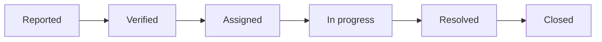
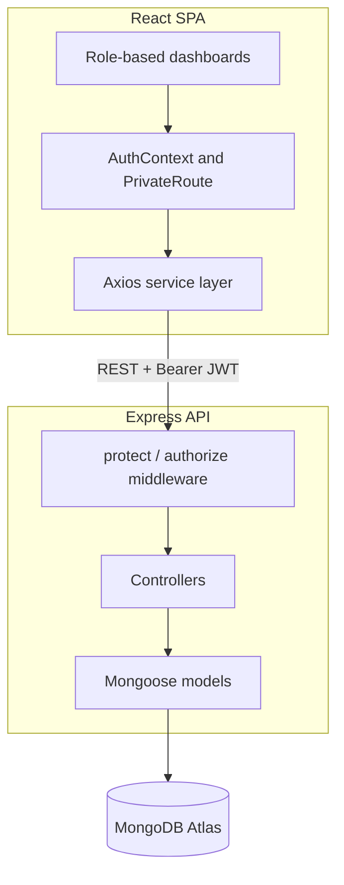

# NagarSetu


NagarSetu (नगरसेतु, "City Bridge") is a full-stack civic issue reporting platform. Citizens report problems such as potholes, broken street lights, or overflowing drains. Administrators verify and route them to the right department. Officers work on them and mark them resolved. Every step is tracked and every change notifies the citizen.

Frontend: Vercel. Backend: Render. Database: MongoDB Atlas.

Live demo: _add URL_

## Motivation

Reporting a civic issue is easy. Finding the right department, and knowing whether anyone acted on the report, is not. NagarSetu gives citizens a single place to report, and gives municipal staff a structured workflow to respond, with a full audit trail for each complaint.

## Features

**Citizens**
- Report issues with title, description, category (19 types), priority, photos, and a pinned map location
- Track each complaint through its lifecycle
- Receive notifications on every status change
- Upvote complaints to surface urgent issues
- Comment on complaints and rate resolutions (1 to 5)

**Administrators**
- Verify incoming complaints
- Assign verified complaints to department officers
- View analytics: category breakdown, status distribution, trends
- Manage officers and departments

**Officers**
- View assigned complaints
- Mark complaints in progress, with notes
- Resolve complaints; the citizen is notified automatically
- View personal stats: assigned, in progress, resolved, closed

## Complaint Lifecycle



Status values: `submitted`, `verified`, `assigned`, `in_progress`, `resolved`, `closed`. Each transition is appended to the complaint's `timeline`.

## Tech Stack

| Layer | Technologies |
|---|---|
| Frontend | React 19, Vite 8, React Router 7, Axios, React-Leaflet, Bootstrap, Lucide, React-Toastify |
| Backend | Node.js, Express 5, Mongoose 9, JWT, bcryptjs |
| Database | MongoDB Atlas |
| Hosting | Vercel (client), Render (server) |

## Architecture



## Project Structure

```
nagarsetu/
├── client/
│   ├── src/
│   │   ├── components/              Reusable UI components
│   │   ├── context/AuthContext.jsx  Global auth state
│   │   ├── pages/
│   │   │   ├── Admin/               Dashboard, VerifyIssues, AssignOfficers
│   │   │   ├── Auth/                Login, Signup
│   │   │   ├── Citizen/             Dashboard, ReportIssue, MyComplaints, Details
│   │   │   ├── LandingPage/         Public landing page
│   │   │   └── Officer/             Dashboard, OfficerWork
│   │   ├── routes/PrivateRoute.jsx  Role-based route guards
│   │   └── services/api.js          Axios client
│   └── .env.example
└── server/
    ├── src/
    │   ├── config/
    │   │   ├── db.js                MongoDB connection
    │   │   └── seedDepartments.js   Seeds departments and admin on first run
    │   ├── controllers/             Business logic
    │   ├── middleware/auth.js       JWT verification and role checks
    │   ├── models/                  User, Complaint, Department, Comment, Notification
    │   └── routes/                  Route definitions
    ├── server.js                    Entry point
    └── .env.example
```

## Getting Started

### Prerequisites

- Node.js 18 or later
- A MongoDB Atlas cluster (free tier is enough)
- Git

### Install

```bash
git clone https://github.com/Adi-Marathe/Nagarsetu.git
cd Nagarsetu

cd server && npm install
cd ../client && npm install
```

### Configure

```bash
cp server/.env.example server/.env
cp client/.env.example client/.env
```

See [Environment Variables](#environment-variables) for the values.

### Run

In two terminals:

```bash
cd server && npm run dev
```

```bash
cd client && npm run dev
```

The app runs at `http://localhost:5173`. On first start, the server seeds six departments and a default admin account.

### Default admin (development only)

| Email | Password |
|---|---|
| `admin@nagarsetu.local` | `Admin@123` |

Override with `ADMIN_EMAIL` and `ADMIN_PASSWORD` in production.

## Environment Variables

**server/.env**

| Variable | Description |
|---|---|
| `MONGO_URI` | MongoDB connection string |
| `JWT_SECRET` | Secret for signing tokens |
| `PORT` | API port (default `5000`) |
| `NODE_ENV` | `development` or `production` |
| `CLIENT_ORIGIN` | Allowed frontend origin for CORS |
| `ADMIN_EMAIL` | Optional. Seeded admin email |
| `ADMIN_PASSWORD` | Optional. Seeded admin password |

Generate a JWT secret:

```bash
node -e "console.log(require('crypto').randomBytes(64).toString('hex'))"
```

**client/.env**

| Variable | Description |
|---|---|
| `VITE_API_URL` | Backend base URL, e.g. `http://localhost:5000/api` |

## API Reference

Base path: `/api`. Protected routes need `Authorization: Bearer <token>`.

<details>
<summary>Auth</summary>

| Method | Endpoint | Access | Description |
|---|---|---|---|
| POST | `/auth/register` | Public | Register a user |
| POST | `/auth/login` | Public | Log in, returns JWT |
| GET | `/auth/profile` | Authenticated | Get current user |
| PUT | `/auth/profile` | Authenticated | Update profile |

</details>

<details>
<summary>Complaints</summary>

| Method | Endpoint | Access | Description |
|---|---|---|---|
| POST | `/complaints` | Citizen | Create a complaint |
| GET | `/complaints` | Authenticated | List complaints (filtered by role) |
| GET | `/complaints/all` | Admin | List all complaints |
| GET | `/complaints/:id` | Authenticated | Get complaint details |
| PUT | `/complaints/:id/status` | Admin, Officer | Update status |
| PUT | `/complaints/:id/upvote` | Authenticated | Toggle upvote |
| PUT | `/complaints/:id/feedback` | Citizen | Rate a resolved complaint |

</details>

<details>
<summary>Admin</summary>

| Method | Endpoint | Access | Description |
|---|---|---|---|
| GET | `/admin/stats` | Admin | Dashboard statistics |
| PUT | `/admin/verify/:id` | Admin | Verify a complaint |
| PUT | `/admin/assign/:id` | Admin | Assign to an officer |
| GET | `/admin/officers` | Admin | List officers |
| GET | `/admin/departments` | Admin | List departments |

</details>

<details>
<summary>Officer</summary>

| Method | Endpoint | Access | Description |
|---|---|---|---|
| GET | `/officer/complaints` | Officer | Assigned complaints |
| GET | `/officer/stats` | Officer | Personal stats |
| PUT | `/officer/progress/:id` | Officer | Mark in progress |
| PUT | `/officer/resolve/:id` | Officer | Resolve complaint |

</details>

<details>
<summary>Comments and Notifications</summary>

| Method | Endpoint | Access | Description |
|---|---|---|---|
| POST | `/comments/:complaintId` | Authenticated | Add a comment |
| GET | `/comments/:complaintId` | Authenticated | Get comments |
| GET | `/notifications` | Authenticated | Get notifications |
| PUT | `/notifications/:id/read` | Authenticated | Mark one as read |
| PUT | `/notifications/read-all` | Authenticated | Mark all as read |

</details>

## Database Models

| Model | Fields |
|---|---|
| User | name, email, hashed password, role (`citizen`, `admin`, `officer`), phone, department ref |
| Complaint | title, description, category, status, priority, location (address, lat/lng), images, citizen, department, assigned officer, upvotes, timeline, feedback, resolved timestamp |
| Department | name, code, description, categories, head, contact info |
| Comment | complaint ref, user ref, text, timestamps |
| Notification | user ref, title, message, type, read status, optional complaint ref |

Seeded departments: Public Works (`PWD`), Sanitation (`SAN`), Water Supply (`WSD`), Electricity (`ELEC`), Health (`HEALTH`), Transport (`TRANS`).

## Deployment

**Frontend (Vercel)**
1. Import the repo and set the root directory to `client`.
2. Add `VITE_API_URL=https://<backend>.onrender.com/api`.
3. Deploy.

**Backend (Render)**
1. Create a Web Service with root directory `server`.
2. Build command `npm install`, start command `npm start`.
3. Set `MONGO_URI`, `JWT_SECRET`, `CLIENT_ORIGIN` (your Vercel URL), `NODE_ENV=production`, `ADMIN_EMAIL`, `ADMIN_PASSWORD`.
4. Deploy.

## Security

- Passwords hashed with bcrypt (10 salt rounds) and excluded from queries by default
- JWT with 30-day expiry, verified on every protected route
- Role-based middleware: `protect` validates the token, `authorize` checks the role
- CORS restricted to a configured origin whitelist
- Security headers: `X-Content-Type-Options`, `X-Frame-Options`, `X-XSS-Protection`
- Mongoose schema validation on all inputs

## Roadmap

- [ ] Real-time notifications (WebSocket)
- [ ] Email and SMS alerts
- [ ] Complaint density heatmap
- [ ] Department performance metrics
- [ ] Escalation of overdue complaints
- [ ] Multi-language support (Hindi, Marathi)
- [ ] Progressive Web App

## Contributing

1. Fork the repository.
2. Create a branch: `git checkout -b feature/your-feature`
3. Commit: `git commit -m "feat: your change"`
4. Push: `git push origin feature/your-feature`
5. Open a pull request.

Keep pull requests focused and describe what changed and why.

## License

MIT. See [LICENSE](LICENSE).

## Author

Aditya Marathe. [GitHub](https://github.com/Adi-Marathe), [LinkedIn](https://linkedin.com/in/adityamarathe234)
